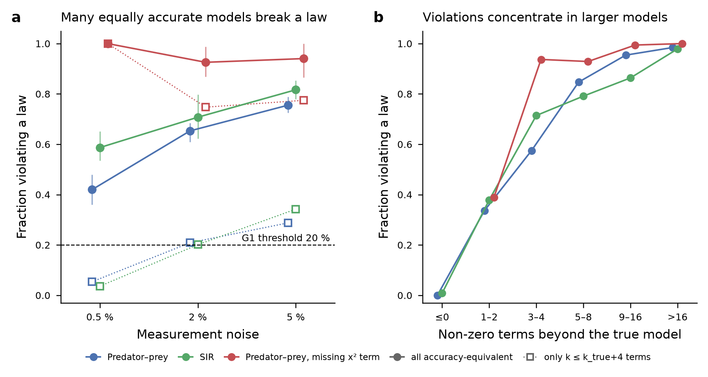
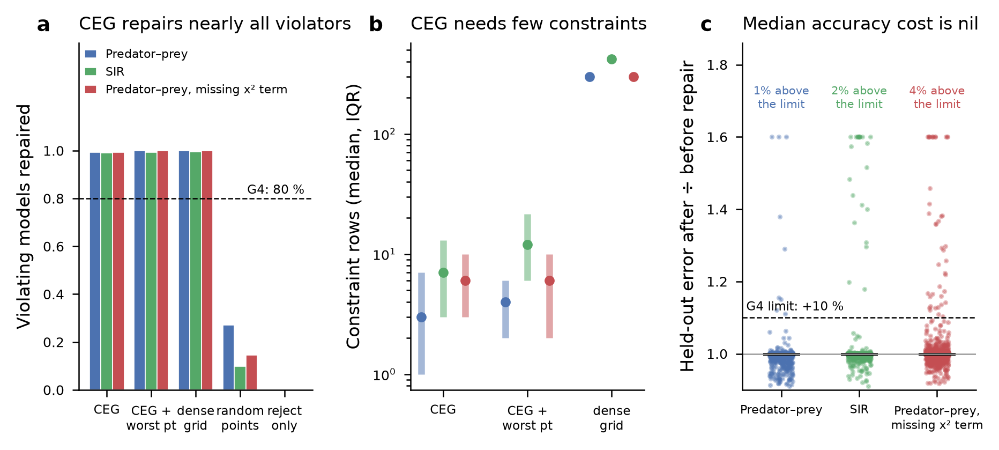

# good-fit-not-physical-law

If an equation found from data predicts held-out data as well as the best one, can it still break a physical law it is supposed to obey? How often, where, and what fixes it?

Short answer so far: yes, very often, on simulated and real data. The violations sit almost entirely in states the data never visited. Building the law into the model's form fixes only the laws that form contains, and can make other laws worse. On systems with two to four variables a dense grid or random sampling finds and fixes what occurs, so an exact solver is not needed for search. Its value is the certificate and the small number of constraints.

Where this goes next is in [`docs/ROADMAP_v3.md`](docs/ROADMAP_v3.md): working out exactly where the data decide whether a law holds, and which new measurement settles the rest.

Every experiment below had its protocol and pass rules committed before it ran. Failed rules stay in the tables.

## Setup in one paragraph

Systems: logistic predator-prey (A), SIR with varying population (B), A with the x^2 term removed from the library (A-mis), Holling type II predator-prey, whose truth is not a polynomial (H), a four-state SEIR (E4), hare-lynx pelt records 1845-1935 (R), and COVID-19 reported cases for 10 countries (E). Models come from sparse regression (STLSQ) over polynomial libraries. "Accuracy-equivalent" means held-out error within 10% of the best candidate. Laws are polynomial sign conditions that are linear in the model coefficients: positivity, trapping region, S' <= 0, R' >= 0, conservation. The checker is z3 with exact rational arithmetic plus a Bernstein branch-and-bound fallback. Repair adds each counterexample as a linear constraint and refits (C). The baselines are structure only (S, for example x' = x h(x, y)), a loop that takes its counterexamples from random sampling (Rnd), and soft penalties on a grid (Soft).

## Results

| unit | what it tested | frozen / run | outcome | doc |
|---|---|---|---|---|
| Pilot | gap, checker, repair, vs ordinary validation | protocol + addenda A-C | REVISE. 42-82% of equivalent models break a law (93-100% A-mis). Checker sound: 0 disagreements in 14,212 cross-checks. Repair 99.25% at median error x0.9993. **Fail:** AIC already ranks violators (AUROC 0.966), and 200 random points catch 97.6% | [pilot_report](docs/pilot_report.md) |
| 0A | witness loop vs structure vs random | 2026-11-08 | withdrawn: the B structure masked a true term | [gate_A](docs/gate_A_result.md) |
| 0A2 | same, corrected B | f996151e | Outcome 3. Counterexamples beat structure (C-S 0.317). Witnesses barely beat random ones (C-Rnd 0.017, 1 of 60) | [gate_A2](docs/gate_A2_result.md) |
| 0B | truth outside the library (H), narrow "needle" violations, 20 seeds | 9f1cf045 | G-B1 pass: 3365/3456 = 0.974 of equivalent H models break a law. G-B2 pass: C repairs 160/160. **G-B3 fail:** 0/3365 natural violations are narrow (smallest volume 0.064), so a sampler finds them. Replication pass | [gate_B](docs/gate_B_result.md) |
| 0R | real series: hare-lynx | frozen 0ad1896c, run fcfb358d | G-R1, G-R2, G-R3 pass. The selected model breaks hare positivity and the trapping law. 45/47 equivalent models break a law, C repairs 47/47. Fits are poor (validation error 0.89 training sd) | [gate_R](docs/gate_R_result.md) |
| taxonomy | which laws structure enforces | from existing runs | Positivity and conservation are enforced by form. Trapping and monotone laws need a check. Structure alone dropped H trapping-law satisfaction from 0.87 to 0.35 | [law_taxonomy](docs/law_taxonomy.md) |
| 0E | real series: COVID-19, 10 countries | 942d55e5 | G-E1 pass (10/10 selected models break a law), G-E2 pass (35/35). **G-E3 fail:** repair costs accuracy (median validation ratio 1.465). The structure that was exact on synthetic SIR leaves B2R open in 24/35 | [gate_E](docs/gate_E_result.md) |
| 0C | robustness: soft penalty, noise, independent sampling | 2109feba | Soft penalty on a dense grid verifies 320/320, same as C, so the loop is not needed at <= 3 states. Outcome 3 holds at 0.5% and 5% noise. 0/2871 accepted models fail 200k-point sampling. At 0.5% noise with a wrong library, repair costs accuracy (1.42-1.49) | [gate_C](docs/gate_C_result.md) |
| 0D | four states (E4) | frozen 3cbcb2e9, run 3641866a | Fine grid 80/80 (5148 rows), loop 69/80 (15 rows), pilot-budget grid 64/80, random loop 51/80, structure 7/80. **R-D1 not supported** (no coverage edge over a grid). C-Rnd grows to 0.225 | [gate_D](docs/gate_D_result.md) |
| S1 | Navier-Stokes closure energy test | frozen, not run | side track, parked | [protocol_S1](docs/protocol_S1.md) |



*Pilot. Left: share of accuracy-equivalent models that break a law, by noise level, for all candidates and for parsimonious ones. Right: the share rises with the number of terms beyond the true model.*



*Pilot repair. Counterexample-guided repair (CEG) fixes almost every violator with a few constraint rows. A dense grid needs about 300-450 rows. Random points at the same row budget fix 10-27%. The median accuracy cost is nil.*

## What I take from it

1. A good fit is not evidence that a law holds. This held in every system and both real series.
2. The violations are where there is no data. On hare-lynx the positivity witnesses are on the faces of the state box and the trapping witness is at hare = 5, while the smallest observed values are 0.03 and 0.11. On COVID the data sit in a corner of the simplex (I <= 0.0154, S >= 0.89). This is the thread ROADMAP_v3 follows.
3. Structure enforces exactly the laws it contains. If it excludes the truth it can make other laws worse (H trapping law, COVID B2R and B1S).
4. On 2-4 state systems the search part is easy. Random sampling and dense grids catch natural violations. The exact checker earns its place through certificates, through far fewer constraint rows (24 times fewer than the pilot-budget grid and over 300 times fewer than the fine grid at four states), and at four states through beating random counterexamples.
5. Repair is cheap only when the fit is good. It cost accuracy on COVID and at low noise with a wrong library.

## What this does not show

- Real-data fits are poor: validation error above 1 training sd in 8 of 10 countries.
- The COVID panel is 10 correlated series from one pandemic, with 35 equivalent candidates in total.
- Synthetic systems have at most four states.
- There is no theorem yet.

## Layout

| path | what |
|---|---|
| `src/` | systems and laws (`systems.py`), library and STLSQ (`lib.py`, `sindy.py`, `pool.py`), checkers (`verify.py`, `bern.py`, `bern_nd.py`), oracle (`oracle.py`), repair (`ceg.py`), one script set per protocol (`gate_a*.py`, `gate_b.py`, `needles.py`, `real_r.py`, `real_e.py`, `robust.py`, `dimtest.py`, `run_0*.py`, `analyze_0*.py`) |
| `docs/` | protocols, results, roadmaps (v3 is current, v2 and v1 kept as history) |
| `results/` | per-job JSON and summary CSVs for every run |
| `data_raw/` | hare-lynx pelts (CRAN tsibbledata 0.4.1), JHU CSSE COVID files with sha256 in `docs/protocol_0E.md` |
| `tools/` | Kaggle launcher (`kaggle_launch.py`, `kaggle_0*.py`), GitHub push (`gh_push.py`), checks (`check_holling.py`, `check_mask.py`, `check_lawmap_math.py`), `law_table.py` |
| `tests/` | checker tests on hand-built good and bad models |
| `skills/` | write-ups of the verification, repair, sandbox and preregistration workflows |

## Run

```
conda env create -f environment.yml
conda activate ceg-ode
python tests/test_verifier.py
python tools/check_lawmap_math.py          # identities used in ROADMAP_v3
python tools/kaggle_launch.py push D <commit> <kaggle_user> test   # any protocol: B, R, E, C, D
python tools/kaggle_launch.py status D <kaggle_user>
python tools/kaggle_launch.py fetch D <kaggle_user> <dir>
python src/analyze_0D.py
```

Heavy runs go to Kaggle CPU kernels, which pull the frozen commit from this repo. Gate thresholds are compared as exact fractions. `src/savgol_np.py` replaces `scipy.signal`, which was blocked on the machine this was developed on.

## AI use

See `AI_USE.md`.
